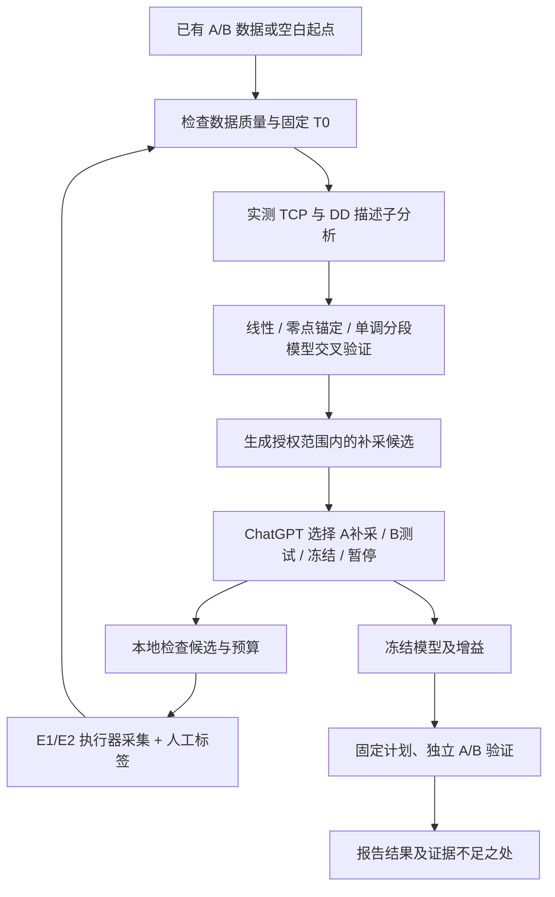

# Agentic 主动采集：怎么用、会做什么

这是独立入口 `agentic`，复用 E1/E2 的实机执行器。原来的 `e1e2`、`analyze_e1e2`、`setup/run` 命令保持原样。无需重新完成 station_profile。

你只需确定本轮允许探索的范围和总预算，摆瓶、恢复固定 T0、给每次试验打标签。程序自动分析、补采、更新触觉模型、测试纠正效果，最后冻结规则并进行独立验证。

## 1. 第一次连接账号

使用你已有的 **Robot Supervisor Probe** ChatGPT 授权，账号凭据保存在 5090 容器的 `/root/.config/bottle-agentic`，不写入实验目录或 Git。登录和分析都不发机器人指令。

若 5090 通过笔记本的 7890 代理联网，在**笔记本**打开一个终端：

```bash
cd /home/lenovo/wfb/bottle_grasp_experiment
bash agentic_tunnel.sh
```

保持终端开着。若提示端口已占用，先检查是否已经有本项目的隧道，不要重复启动。当前部署时建立的隧道仍在运行；重启笔记本后需要重新开。若本机代理不是 7890，使用 `AGENTIC_LOCAL_PROXY_PORT=实际端口 bash agentic_tunnel.sh`。

在 **5090 的项目目录**，宿主机或现有 ROS 容器内均可：

```bash
cd /home/dm/DM_das/bottle_grasp_experiment
bash run_on_5090.sh agentic auth status
bash run_on_5090.sh agentic auth login
```

在笔记本浏览器打开终端打印的链接并完成登录。已经登录且有效时不必再次 login。验证实际模型权限：

```bash
bash run_on_5090.sh agentic auth test
```

`auth models` 查看账号目录；目录可见不等于可调用，以 `auth test` 成功为准。默认从账号目录选择模型；可以在 `config.agentic.yaml` 的 `provider.model` 固定已经测试成功的模型。`auth logout` 请求撤销此可续期会话并清除本地令牌；若返回 `remote_revocation=unconfirmed`，说明远端撤销未确认，可到账号的应用权限页面处理。

如果 5090 有自己的联网方式，可以在配置中改 `provider.proxy`。设置为空字符串表示直接联网，`null` 表示使用环境代理。该设置在开始 campaign 后不能再改动该 campaign 的快照。

## 2. 开始你当前的小范围主动采集

已有 A 正式数据可以作为起点。下面命令**会进入实机流程**，必须由你在现场启动：

```bash
bash run_on_5090.sh agentic run --real \
  --seed-session outputs/e1e2_A_formal01 \
  --out outputs/agentic_local01
```

默认配置的范围为 **−2 至 +10 mm**，候选网格间隔 **2 mm**，最多 **120 次新增尝试**，最多 **10 个探索批次**，运行时间预算 **4 小时**。这些是本轮的范围限制，不表示程序必定做满。已有种子数据不计入新增预算。

按终端提示操作：

1. 停止其它遥操／推理进程，把瓶子放回原标记、夹爪完全张开，恢复种子 A 的原 T0 和原朝向。终端会打印固定 T0；程序不会把新的姿态悄悄当成零点。
2. 程序展示本批全部偏移及基座变化。第一段动作前输入 `MOVE`。初次需要时仍会扣零、轻触和接受 T0；后续批次沿用固定 T0。
3. 按提示放置 light 或 heavy 瓶。每次结束给标签，并复位瓶子。
4. 每批结束后，程序分析已有数据，打印 Agent 选择下一批的理由。默认在本轮已授权范围内自动进入下一批，换瓶和标签仍需要你。
5. 满足学习条件或到达探索预算后，冻结模型和纠正增益，再跑固定的 A/B 验证计划。结束打印报告位置。

如果希望**每批都重新输入 MOVE**，首次创建时加 `--approval batch`。默认 `campaign` 只在本进程第一次运动及暂停恢复等需要重新授权的位置确认，不取消原执行器的异常处理。

想从新瓶位、新 T0 完全开始，就去掉 `--seed-session` 并使用新的输出目录。不要把不同瓶位、不同传感器安装或不同力参数的数据强行合并。可重复指定 `--seed-session` 导入同一固定 T0、协议一致的 A/B 历史记录；B 只作为效果反馈，不用来拟合观察到偏移的映射。

想指定别的范围，例如 −10 至 +10 mm：

```bash
bash run_on_5090.sh agentic run --real \
  --scope -10 10 --max-trials 160 --max-batches 10 \
  --out outputs/agentic_range01
```

使用 `--scope` 时，独立验证点自动改为该范围的下界、0、上界。更细的网格、不同验证点和重复数可在新 campaign 开始前编辑 `config.agentic.yaml`。输出目录已经存在 campaign 时不能覆盖范围或预算；这样可以保留实验的可追溯性。

## 3. 每次仍使用熟悉的标签

菜单顶部提示先确认瓶子在标记处，必要时复位。

| 输入 | 含义 |
|---|---|
| 回车 / `1` | 正常 |
| `2` | 倾倒 |
| `3` | 推动 |
| `4` | 掉落 |
| `5` | 滑动 |
| `0` | 作废 |
| `n` | 加备注 |
| `q` | 当前试验结束后退出，保留断点 |

倾倒、推动、掉落后按原流程复位。自动检测与人工标签都保存，Agent 不能修改你的标签。成功仍按原规则判断：数据记录完整、完成提起/HOLD、未检测到掉落且人工标签正常。

## 4. 暂停、续跑和查看结果

安全结束当前试验时优先在标签菜单输入 `q`。下次：

```bash
bash run_on_5090.sh agentic resume --real --out outputs/agentic_local01
```

相同目录保留原 T0、模型版本、待做计划和总预算。已完成的 campaign 直接报告结果，不连接硬件。不要同时启动两个采集进程。

下面这些只操作文件，不连接机器人：

```bash
bash run_on_5090.sh agentic status --out outputs/agentic_local01
bash run_on_5090.sh agentic plan --out outputs/agentic_local01
bash run_on_5090.sh agentic analyze --out outputs/agentic_local01
```

`status` 看当前状态；`plan` 重新分析并列出下一批合法候选，不执行候选；`analyze` 更新报告。

Ctrl+C 沿用 E1/E2：停止机械臂，未提起时松开，已提起时保持夹爪并提示现场处理。逐指力上限触发时仍优先松开。若上次在空中中断，程序拒绝自动恢复。你把瓶子安全放回、夹爪全开并恢复原 T0 后，再运行：

```bash
bash run_on_5090.sh agentic recover --out outputs/agentic_local01
```

读提示并输入 `RECOVERED`，程序只记录人工恢复声明，**不发运动**。随后执行 resume，程序仍会读取实测开度和位姿，首段动作仍需 MOVE。未完成现场处理不要输入恢复声明。

## 5. Agent 具体更新什么



- **观察规律**：从 A 的初次 PROBE 质心估计 a 偏移。优先使用 PROBE 时刻的实测 TCP，对齐固定 T0。旧记录只有计划 δ 时会明确标记，不能据此宣布毫米精度验收通过。
- **模型更新**：比较普通线性、实测零点锚定线性和单调分段模型；按物理试验分组或 session 留出检验，不把同一次的多帧当成独立样本。复杂模型必须实际改善验证误差才采用。
- **补采更新**：优先缺失点、高不确定性点、零偏差附近、局部偏差附近和范围端点。2 mm 是当前配置的候选分辨率，Agent 不会越过授权范围。需要允许更宽探索，应先给新 campaign 更宽的上下限。
- **B 反馈**：检测纠正后反向过冲、零偏差、双指估计不一致和被运动限幅挡住的纠正。由此选择补 A 数据或试验较小增益。B 的纠正模块只看触觉和接触状态，不看试验计划 δ。
- **策略更新**：只在允许的 `[0.5, 0.75, 1.0]` 增益中选择并前瞻测试；比较相同瓶子/偏移单元的成功和重抓次数。不会凭历史回放伪造“新规则抓取成功”。
- **停止判断**：范围覆盖、留出 MAE/P90 和当前模型的 B 反馈满足要求时可冻结；连续 A 更新收益过低、预算到达或无可执行候选也可停止探索，但会说明并非已经证明模型足够好。

模型只选择受检查的批次 ID。它没有 shell、ROS 或任意代码执行权限，不能改变力上限、速度、开度下限、TCP 高度下限和运动限幅。采集仍由原 E1/E2 执行器负责。

## 6. 怎样读最终结果

看 `outputs/agentic_local01/REPORT.md`。主要文件如下：

| 路径 | 内容 |
|---|---|
| `campaign.json` | 固定配置、预算、阶段、批次及断点 |
| `analysis/latest.json` | 留出误差、覆盖、噪声、偏差、质量诊断 |
| `models/*.json` | 不可覆盖的触觉模型版本与训练来源 |
| `decisions/*_input.json`、`*_decision.json` | 每次 Agent 看见的摘要、候选和选择理由 |
| `batches/0001/…` | 原 E1/E2 格式的逐试验原始数据、summary.csv、标签、关键帧 |
| `frozen.json` | 独立验证前锁定的模型、增益和停止原因 |
| `validation/report.json` | 固定验证计划的 A/B 成功率、接触率、重抓次数及 Wilson 区间 |
| `analysis/plots/`、`validation/plots/` | 双指映射、误差与覆盖、B 反馈、独立 A/B 成功率等 PNG 图 |
| `recovery_acknowledgements/` | 人工异常恢复声明及恢复前状态 |

默认固定验证在 −2/0/2/6/10 各做 A、B 各 4 次，轻重瓶各半，共 40 次正式试验加 4 次零点监测，**提前占用总预算中的 44 次**。零点监测和中断重试也计预算；监测不混入最终每档成功率分母。

验证数据不反过来改本轮模型。验证内按瓶子分块，每个偏移的 A/B 成对、随机先后执行。每档 4 次是探索规模，即使全成功，95% Wilson 下界也未必超过 80%，报告会写 `inconclusive`（证据不足）。`complete` 只表示流程完成；`passed` 才表示配置的统计验收通过，`not_met` 表示未达到标准。预算结束同样不等于“已经没有任何数据值得补”。

实际 TCP 位移也不是瓶子被推走后的真实相对偏移；倾倒/推动等记录不会用于映射训练。相机只做原流程规定的关键帧记录，本入口没有自动瓶位图像检查。人工摆瓶和复位仍很重要。

## 7. 常见停止原因

| 提示/状态 | 下一步 |
|---|---|
| ChatGPT 连接失败、429、授权过期 | 保持现场安全，恢复代理或登录后 resume；不会暗中改用假 Agent |
| 当前 TCP 不在固定 T0 或记录的退让位 | 按提示恢复原 T0，不能在不同位置重新定义零点续同一轮 |
| 数据协议、T0、硬件配置不一致 | 确认来源，使用一致的数据；需要换配置时新建 campaign |
| DD 缺失、闭合失败、力不稳定 | 按原 E1/E2 故障处理；Agent 不会通过放松安全条件解决 |
| `no_usable_model` | 当前范围/数据没有形成可用映射，查看质量诊断；调整现场或范围再建新轮 |
| `budget_exhausted` | 预算用完，保留全部结果；不会自动扩预算 |
| `inconclusive` | 验证证据还不足，查看是样本少、覆盖不够还是实际失败，不应当作通过 |

## 8. 不接机器人检查流程

真实账号加模拟机器人：

```bash
bash run_on_5090.sh agentic run --simulate --out outputs/agentic_sim_chatgpt01
```

完全离线的确定性规划器（明确不调用 LLM）：

```bash
bash run_on_5090.sh agentic run --simulate --provider deterministic \
  --out outputs/agentic_sim_offline01
```

模拟数据会显式标记，不可和实机数据混合。`--real` 与 `--simulate` 必须二选一；同一输出目录不能互换。

接入方式依据官方 [Sign in with ChatGPT](https://learn.chatgpt.com/docs/sign-in-with-chatgpt) 和 [Models and inference](https://developers.openai.com/siwc/token-sharing-open-source/models-and-inference)。应用额度及实际可用模型由账号授权和服务端返回决定。
