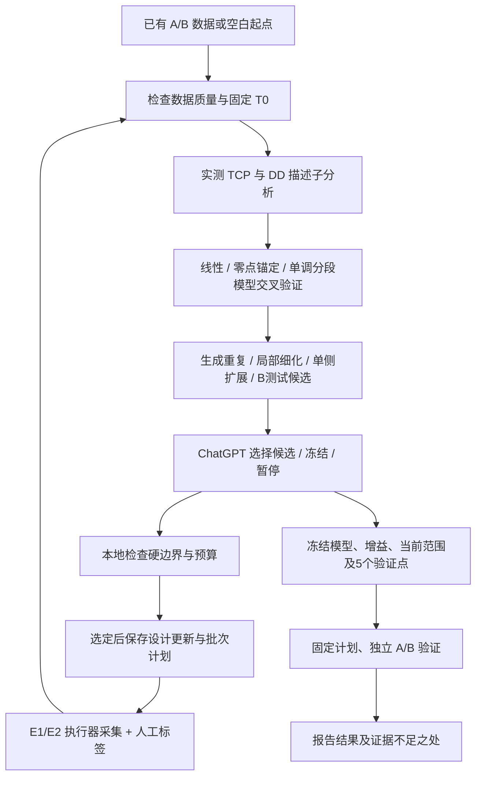

# Agentic 主动采集：怎么用、会做什么

这是独立入口 `agentic`，复用 E1/E2 的实机执行器。原来的 `e1e2`、`analyze_e1e2`、`setup/run` 命令保持原样。无需重新完成 station_profile。

你可以直接使用默认预算启动，摆瓶、恢复固定 T0、给每次试验打标签。程序从已有 A 数据确定初始探索范围和档距，随后根据证据选择局部加密、重复、向外扩展或 B 测试；更新触觉模型和纠正增益，最后冻结规则并进行独立验证。

当前默认开启自适应设计（`scope.adaptive: true`）。**硬范围固定，当前探索范围和名义采样间距可以自动变化。** 默认硬范围是相对 T0 沿 a 的 −25 至 +25 mm；这沿用原抓取平移限幅，不代表这些位置都能执行或都会采集。TCP 高度、退让、提起、力和开度检查仍然生效。

## 1. 第一次连接账号

使用你已有的 **Robot Supervisor Probe** ChatGPT 授权，账号凭据保存在 5090 容器的 `/root/.config/bottle-agentic`，不写入实验目录或 Git。登录和分析都不发机器人指令。

若 5090 通过笔记本的 7890 代理联网，在**笔记本**打开一个终端：

```bash
cd /home/lenovo/wfb/bottle_grasp_experiment
bash agentic_tunnel.sh
```

保持终端开着。若提示端口已占用，先检查是否已经有本项目的隧道，不要重复启动。当前部署时建立的隧道仍在运行；重启笔记本后需要重新开。若本机代理不是 7890，使用 `AGENTIC_LOCAL_PROXY_PORT=实际端口 bash agentic_tunnel.sh`。

在 **5090 的项目目录**，宿主机或现有 ROS 容器内均可：

```bash
cd /home/dm/DM_das/bottle_grasp_experiment
bash run_on_5090.sh agentic auth status
bash run_on_5090.sh agentic auth login
```

在笔记本浏览器打开终端打印的链接并完成登录。已经登录且有效时不必再次 login。验证实际模型权限：

```bash
bash run_on_5090.sh agentic auth test
```

`auth models` 查看账号目录；目录可见不等于可调用，以 `auth test` 成功为准。默认从账号目录选择模型；可以在 `config.agentic.yaml` 的 `provider.model` 固定已经测试成功的模型。`auth logout` 请求撤销此可续期会话并清除本地令牌；若返回 `remote_revocation=unconfirmed`，说明远端撤销未确认，可到账号的应用权限页面处理。

如果 5090 有自己的联网方式，可以在配置中改 `provider.proxy`。设置为空字符串表示直接联网，`null` 表示使用环境代理。该设置在开始 campaign 后不能再改动该 campaign 的快照。

## 2. 开始自动选范围与档距的采集

已有 A 正式数据可以作为起点。下面命令**会进入实机流程**，必须由你在现场启动：

```bash
bash run_on_5090.sh agentic run --real \
  --seed-session outputs/e1e2_A_formal01 \
  --out outputs/agentic_adaptive01
```

默认最多 **120 次新增尝试**、**10 个探索批次**，运行时间预算 **4 小时**。其中提前预留 **44 次**给最终独立验证，已有种子数据不计入新增预算。程序不会为了做满预算重复采集。

初始设计自动确定：

- 有历史 A 数据：从协议一致、触觉有效且有实测 TCP 的 A 位置确定当前范围，范围包含零点；用已有有效档位间距的中位数作为起始名义档距，并限制在固定硬范围内。
- 没有足够的有效实测 A 数据：使用冷启动起点 **−2 至 +10 mm、2 mm 名义间隔**。这只是起点，后续可以细化或扩展。
- 只有 B 历史数据：B 用于诊断纠正表现，不代替 A 的映射标定；缺少有效 A 起点时仍按冷启动处理。

终端会打印实际采用的 `design`。不需要提前把下一轮 offsets 列表写好。

按终端提示操作：

1. 停止其它遥操／推理进程，把瓶子放回原标记、夹爪完全张开，恢复种子 A 的原 T0 和原朝向。终端会打印固定 T0；程序不会把新的姿态悄悄当成零点。
2. 程序展示本批全部偏移及基座变化。第一段动作前输入 `MOVE`。初次需要时仍会扣零、轻触和接受 T0；后续批次沿用固定 T0。
3. 按提示放置 light 或 heavy 瓶。每次结束给标签，并复位瓶子。
4. 每批结束后，程序分析已有数据，打印 Agent 选择下一批的理由。可能补重复、局部加密、向单侧扩展，或使用当前模型跑 B。只有候选通过检查且被选定，才更新 `design` 并生成本批计划；未选中的提案不会改变当前设计。默认在固定硬范围内自动进入下一批，换瓶和标签仍需要你。
5. 满足停止条件或结束探索时，冻结模型、纠正增益和当前探索范围，并据此锁定含两端与零点的 **5 个验证位置**。然后执行固定的独立 A/B 验证，验证期间不再改点位或模型。预算或数据不足以完成验证时，报告会明确说明。

如果希望**每批都重新输入 MOVE**，首次创建时加 `--approval batch`。默认 `campaign` 只在本进程第一次运动及暂停恢复等需要重新授权的位置确认，不取消原执行器的异常处理。

想从新瓶位、新 T0 完全开始，就去掉 `--seed-session` 并使用新的输出目录。不要把不同瓶位、不同传感器安装或不同力参数的数据强行合并。可重复指定 `--seed-session` 导入同一固定 T0、协议一致的 A/B 历史记录；B 只作为效果反馈，不用来拟合触觉描述子到偏移的映射。

如果这次只想在 −10 至 +10 mm 内探索，首次启动时限定硬范围：

```bash
bash run_on_5090.sh agentic run --real \
  --scope -10 10 --max-trials 160 --max-batches 10 \
  --out outputs/agentic_adaptive_bounded01
```

**自适应模式下，`--scope` 指定不可越过的硬边界，不是要求机器人立即扫描整个区间。** 初始设计仍由有效 A 数据推断，冷启动范围会裁到这些硬边界内；当前探索范围随后可在硬边界内变化。最终验证点在冻结时根据当时的探索范围生成，不是启动时直接把硬边界当成验证目标。

如果只想继续此前的小范围研究，可改用 `--scope -2 10`。步长下限、单次扩展上限、验证点数和重复数可以在**创建新 campaign 前**修改 `config.agentic.yaml`；默认细化下限为 **0.5 mm**，每次向一侧最多扩展 **5 mm**。

**旧 campaign 继续使用创建时的配置快照。** 如果快照里没有 `scope.adaptive: true`，升级代码后续跑仍是原来的固定范围行为。要用新的自适应功能，请使用新 `--out`，并用 `--seed-session` 导入一致的旧 A/B 数据。不能在已有输出目录上用 `--scope` 等参数覆盖已保存的范围、预算或设计规则。

## 3. 每次仍使用熟悉的标签

菜单顶部提示先确认瓶子在标记处，必要时复位。

| 输入 | 含义 |
|---|---|
| 回车 / `1` | 正常 |
| `2` | 倾倒 |
| `3` | 推动 |
| `4` | 掉落 |
| `5` | 滑动 |
| `0` | 作废 |
| `n` | 加备注 |
| `q` | 当前试验结束后退出，保留断点 |

倾倒、推动、掉落后按原流程复位。自动检测与人工标签都保存，Agent 不能修改你的标签。成功仍按原规则判断：数据记录完整、完成提起/HOLD、未检测到掉落且人工标签正常。

## 4. 暂停、续跑和查看结果

安全结束当前试验时优先在标签菜单输入 `q`。下次：

```bash
bash run_on_5090.sh agentic resume --real --out outputs/agentic_adaptive01
```

相同目录保留原 T0、模型版本、当前 `design`、设计更新历史、待做计划和总预算。已完成的 campaign 直接报告结果，不连接硬件。不要同时启动两个采集进程。

下面这些只操作文件，不连接机器人：

```bash
bash run_on_5090.sh agentic status --out outputs/agentic_adaptive01
bash run_on_5090.sh agentic plan --out outputs/agentic_adaptive01
bash run_on_5090.sh agentic analyze --out outputs/agentic_adaptive01
```

`status` 看当前状态及 `design/design_history`；`plan` 重新分析并列出下一批合法候选，不选择、不执行候选，也不因为展示扩展或细化提案而改变当前设计；`analyze` 更新报告。新建 campaign 尚无设计时，第一次分析可以根据数据建立初始设计。

Ctrl+C 沿用 E1/E2：停止机械臂，未提起时松开，已提起时保持夹爪并提示现场处理。逐指力上限触发时仍优先松开。若上次在空中中断，程序拒绝自动恢复。你把瓶子安全放回、夹爪全开并恢复原 T0 后，再运行：

```bash
bash run_on_5090.sh agentic recover --out outputs/agentic_adaptive01
```

读提示并输入 `RECOVERED`，程序只记录人工恢复声明，**不发运动**。随后执行 resume，程序仍会读取实测开度和位姿，首段动作仍需 MOVE。未完成现场处理不要输入恢复声明。

## 5. Agent 具体更新什么



- **观察规律**：从 A 的初次 PROBE 质心估计 a 偏移。优先使用 PROBE 时刻的实测 TCP，对齐固定 T0。旧记录只有计划 δ 时会明确标记，不能据此宣布毫米精度验收通过。
- **模型更新**：比较普通线性、实测零点锚定线性和单调分段模型；按物理试验分组或 session 留出检验，不把同一次的多帧当成独立样本。复杂模型必须实际改善验证误差才采用。
- **重复 `repeat`**：同档波动过大，或不同指令档位在实测 TCP 上没有充分分离时，优先补重复、诊断噪声和位置误差，不直接把名义间隔越改越小。
- **局部细化 `refine`**：根据留出误差、局部斜率变化、接触成功/失败转变及 B 反馈，在有价值的局部区间插入测点。设计的名义间距按原值减半，默认最小 **0.5 mm**；不是每轮把全范围所有点重新扫一遍。
- **单侧扩展 `expand_left / expand_right`**：只有该侧边缘有足够的有效实测、双侧接触、达到目标力及成功 A 试验证据，并覆盖轻重瓶，才提出向该侧扩展。一次最多 **5 mm**，同时复测原边缘位置，且始终受固定硬范围约束。
- **新增点的次数**：加密点、外扩点和边缘对照先各做 2 次（轻重瓶各 1 次），得到结果后再决定是否重复；噪声复测可追加重复，不能超出预算。
- **失败和执行跳过**：已有夹空、力未达标、失败或高度限幅跳过等证据，会阻止向相应未知方向盲目扩大。执行约束导致的不可达不叫“触觉能力边界”；程序也不通过缩小当前范围来隐藏已测失败点。
- **B 反馈**：检测纠正后反向过冲、零偏差、双指估计不一致和被运动限幅挡住的纠正。由此选择补 A 数据或试验较小增益。B 的纠正模块只看触觉和接触状态，不看试验计划 δ。
- **策略更新**：只在允许的 `[0.5, 0.75, 1.0]` 增益中选择并前瞻测试；比较相同瓶子/偏移单元的成功和重抓次数。不会凭历史回放伪造“新规则抓取成功”。
- **停止判断**：当前探索范围的覆盖、留出 MAE/P90、当前模型的 B 反馈及待解决设计候选共同决定是否继续。连续 A 更新收益过低、预算到达或无可执行候选也可结束探索，但会说明并非已经证明模型足够好，更不代表整个硬范围都验证过。

**名义间隔不等于实际达到的空间分辨率。** 现有 TCP 到位容差仍为 **2 mm**，不会为了生成 1 mm 或 0.5 mm 候选而自动收紧。程序同时检查实际 TCP 档位分离、重复波动和触觉噪声；结果中的毫米精度只能由实测证据支持。瓶子被推动时，TCP 相对 T0 的位移也不等于相对瓶子的真实偏移。

模型只选择受检查的批次 ID。它没有 shell、ROS 或任意代码执行权限，不能改变力上限、速度、开度下限、TCP 高度下限和运动限幅。采集仍由原 E1/E2 执行器负责。

## 6. 怎样读最终结果

看 `outputs/agentic_adaptive01/REPORT.md`。主要文件如下：

| 路径 | 内容 |
|---|---|
| `campaign.json` | 固定硬范围与配置快照、当前 `design`、`design_history`、预算、阶段、批次及断点 |
| `analysis/latest.json` | 当前设计及硬范围、留出误差、覆盖、噪声、偏差、质量诊断 |
| `analysis/candidate_checks.json` | 本轮候选、通过/拒绝原因和剩余探索预算 |
| `models/*.json` | 不可覆盖的触觉模型版本与训练来源 |
| `decisions/*_input.json`、`*_decision.json` | 每次 Agent 看见的摘要、候选和选择理由 |
| `batches/0001/batch_plan.json` | 选定候选、本批固定点位及 `design_before/design_after` |
| `batches/0001/…` | 原 E1/E2 格式的逐试验原始数据、summary.csv、标签、关键帧 |
| `frozen.json` | 独立验证前锁定的模型、增益、最终当前范围、5个验证点及停止原因 |
| `validation/report.json` | 固定验证计划的 A/B 成功率、接触率、重抓次数及 Wilson 区间 |
| `analysis/plots/`、`validation/plots/` | 双指映射、误差与覆盖、B 反馈、独立 A/B 成功率等 PNG 图 |
| `recovery_acknowledgements/` | 人工异常恢复声明及恢复前状态 |

默认 `validation.adaptive_scope: true`、`points: 5`。**冻结时**，根据最终的当前探索范围生成 5 个互不重复的验证偏移，包含范围两端和 0；具体数值见终端和 `frozen.json` 的 `validation_offsets_mm`。之后即使分析结果变化也不会改这 5 个点。

每个验证偏移的 A、B 各做 **4 次**，轻重瓶各半，共 **40 次正式试验**。原 `zero_every: 10` 设置下另有 **4 次零点监测**，所以仍然**提前预留总预算中的 44 次**；默认总预算仍为 120。零点监测、中断重试和被跳过的计划尝试按预算规则记录，监测不混入最终每档成功率分母。

验证数据不反过来改本轮模型。验证内按瓶子分块，每个偏移的 A/B 成对、随机先后执行。每档 4 次是探索规模，即使全成功，95% Wilson 下界也未必超过 80%，报告会写 `inconclusive`（证据不足）。`complete` 只表示流程完成；`passed` 才表示配置的统计验收通过，`not_met` 表示未达到标准。预算结束同样不等于“已经没有任何数据值得补”。

**5 个验证点只能支持这些位置上的统计结论，不能证明两个点之间每个连续位置都达到相同性能。** 验证范围是冻结时的当前探索范围，不自动等于 −25 至 +25 mm 的整个硬范围。

实际 TCP 位移也不是瓶子被推走后的真实相对偏移；倾倒/推动等记录不会用于映射训练。相机只做原流程规定的关键帧记录，本入口没有自动瓶位图像检查。人工摆瓶和复位仍很重要。

## 7. 常见停止原因

| 提示/状态 | 下一步 |
|---|---|
| ChatGPT 连接失败、429、授权过期 | 保持现场安全，恢复代理或登录后 resume；不会暗中改用假 Agent |
| 当前 TCP 不在固定 T0 或记录的退让位 | 按提示恢复原 T0，不能在不同位置重新定义零点续同一轮 |
| 数据协议、T0、硬件配置不一致 | 确认来源，使用一致的数据；需要换配置时新建 campaign |
| DD 缺失、闭合失败、力不稳定 | 按原 E1/E2 故障处理；Agent 不会通过放松安全条件解决 |
| `no_usable_model` | 当前范围/数据没有形成可用映射，查看质量诊断；调整现场或范围再建新轮 |
| 细化没有继续、改为重复 | 查看实际 TCP 分离和触觉重复噪声；名义步长变小不保证新增信息 |
| 没有提出向外扩展 | 该侧边缘的实测、成功或轻重瓶证据可能不足，或已有失败/执行约束；不能据此称为触觉边界 |
| `budget_exhausted` | 预算用完，保留全部结果和当前设计；不会自动扩预算 |
| `inconclusive` | 验证证据还不足，查看是样本少、覆盖不够还是实际失败，不应当作通过 |

## 8. 不接机器人检查流程

真实账号加模拟机器人：

```bash
bash run_on_5090.sh agentic run --simulate --out outputs/agentic_sim_chatgpt01
```

完全离线的确定性规划器（明确不调用 LLM）：

```bash
bash run_on_5090.sh agentic run --simulate --provider deterministic \
  --out outputs/agentic_sim_offline01
```

模拟数据会显式标记，不可和实机数据混合。`--real` 与 `--simulate` 必须二选一；同一输出目录不能互换。

自适应范围与分辨率的实现规则、持久化和旧数据迁移详见 [自适应设计说明](docs/AGENTIC_ADAPTIVE_20261030.md)。

接入方式依据官方 [Sign in with ChatGPT](https://learn.chatgpt.com/docs/sign-in-with-chatgpt) 和 [Models and inference](https://developers.openai.com/siwc/token-sharing-open-source/models-and-inference)。应用额度及实际可用模型由账号授权和服务端返回决定。
