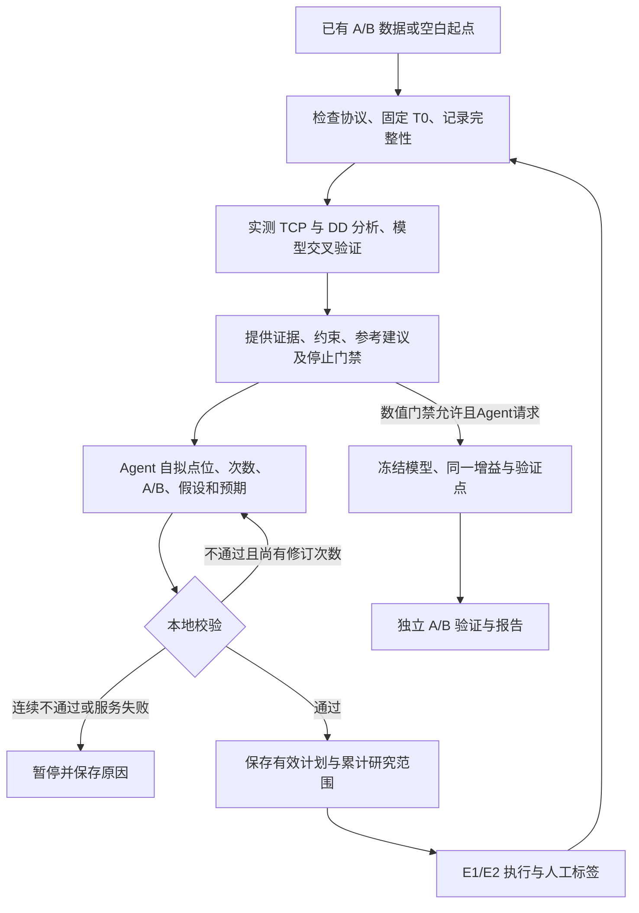

# Agentic 主动采集：怎么用、会做什么

需要“从上次改进经验中更新下一次采集方法、训练 ContactPolicy 并对照验证”时，请使用独立的 [RSI 操作指南](docs/RSI_GUIDE_zh.md)。新入口为 `rsi`（也可 `agentic rsi`），使用新输出目录并复用兼容的旧种子；本文 `agentic run/resume` 的行为不被静默替换。方法能力与证据边界见 [RSI 设计说明](docs/RSI_DESIGN.md)。

这是独立入口 `agentic`，复用 E1/E2 的实机执行器。原来的 `e1e2`、`analyze_e1e2`、`setup/run` 命令保持原样。无需重新完成 station_profile。

新建 campaign 默认使用 **`planning.mode: agent`**：Agent 直接提出下一批的 A/B 条件、每个 a 轴偏移以及各点次数，并说明要验证的假设、证据和预期结果。它可以使用非均匀点位；本地生成的建议只作参考，不是必须从中选一个的白名单，也不强制取中点或把间隔减半。

本地程序检查计划的格式、证据引用、模型、增益、预算和原执行限制。通过后才交给 E1/E2 执行器采集。你仍负责摆瓶、保持原 T0、人工标签、换瓶和必要复位。已有兼容 A/B 数据可以导入，**不要求重新做完已有种子采集**。

默认硬范围是相对 T0 沿 a 的 **−25 至 +25 mm**。当前研究范围在其中累积，不能缩小来隐藏失败；下一批可以只聚焦其中的一小段。一次向一侧最多扩展 5 mm 是明确的探索幅度限制，不是场地安全或可抓取的保证；TCP 高度、退让、提起、力和开度检查仍然生效。所有新点仍沿同一 a 轴，不增加旋转或其它探索方向。

## 1. 第一次连接账号

继续使用你已有的 **Robot Supervisor Probe** ChatGPT 授权；这次规划方式变化不需要更换授权应用。账号凭据保存在 5090 容器的 `/root/.config/bottle-agentic`，不写入实验目录或 Git。登录和分析都不发机器人指令。

若 5090 通过笔记本的 7890 代理联网，在**笔记本**打开一个终端：

```bash
cd /home/lenovo/wfb/bottle_grasp_experiment
bash agentic_tunnel.sh
```

保持终端开着。若提示端口已占用，先检查是否已经有本项目的隧道，不要重复启动。重启笔记本后需要重新开隧道。若本机代理不是 7890，使用 `AGENTIC_LOCAL_PROXY_PORT=实际端口 bash agentic_tunnel.sh`。

在 **5090 的项目目录**，宿主机或现有 ROS 容器内均可：

```bash
cd /home/dm/DM_das/bottle_grasp_experiment
bash run_on_5090.sh agentic auth status
bash run_on_5090.sh agentic auth login
```

在笔记本浏览器打开终端打印的链接并完成登录。已经登录且有效时不必再次 login。验证实际模型权限：

```bash
bash run_on_5090.sh agentic auth test
```

`auth models` 查看账号目录；目录可见不等于可调用，以 `auth test` 成功为准。默认从账号目录选择模型；可以在 `config.agentic.yaml` 的 `provider.model` 固定已经测试成功的模型。`auth logout` 请求撤销此可续期会话并清除本地令牌；若返回 `remote_revocation=unconfirmed`，说明远端撤销未确认，可到账号的应用权限页面处理。

如果 5090 有自己的联网方式，可以在配置中改 `provider.proxy`。设置为空字符串表示直接联网，`null` 表示使用环境代理。该设置在开始 campaign 后不能再改动该 campaign 的快照。

## 2. 从现有数据开始 Agent 自拟计划

已有 A 正式数据可以作为起点。下面命令**会进入实机流程**，必须由你在现场启动：

```bash
bash run_on_5090.sh agentic run --real \
  --seed-session outputs/e1e2_A_formal01 \
  --out outputs/agentic_planning01
```

默认最多 **120 次新增尝试**、**10 个探索批次**，运行时间预算 **4 小时**。其中提前预留 **44 次**给最终独立验证，已有种子数据不计入新增预算。程序不会为了做满预算重复采集。

初始设计自动确定：

- 有历史 A 数据：从协议一致、触觉有效且有实测 TCP 的 A 位置确定当前范围，范围包含零点；用已有有效档位间距的中位数作为起始名义档距，并限制在固定硬范围内。
- 没有足够的有效实测 A 数据：使用冷启动起点 **−2 至 +10 mm、2 mm 名义间隔**。这只是起点，后续可以细化或扩展。
- 只有 B 历史数据：B 用于诊断纠正表现，不代替 A 的映射标定；缺少有效 A 起点时仍按冷启动处理。

终端会打印实际采用的 `design`。它记录累计研究范围和名义间距，不要求后续每批采用统一网格；Agent 会直接给出该批具体的 offsets 与 repetitions。

按终端提示操作：

1. 停止其它遥操／推理进程，把瓶子放回原标记、夹爪完全张开，恢复种子 A 的原 T0 和原朝向。终端会打印固定 T0；程序不会把新的姿态悄悄当成零点。
2. 程序展示本批全部偏移及基座变化。第一段动作前输入 `MOVE`。初次需要时仍会扣零、轻触和接受 T0；后续批次沿用固定 T0。
3. 按提示放置 light 或 heavy 瓶。每次结束给标签，并复位瓶子。
4. 每批结束后，程序把分析证据交给 Agent。Agent 直接提交完整下一批计划，可以补重复、局部加密、向单侧扩展或测试 B，并打印中文理由。通过本地检查后才保存设计和批次计划；拒绝的提案不执行。默认在已授权限制内自动进入下一批，换瓶和标签仍需要你。
5. 数值停止门禁满足时，Agent 才能请求冻结模型与增益，再独立验证。预算结束也可能把当前可用模型临时冻结用于验证，但会标明预算触发和是否满足停止条件，不能解释为已经收敛。冻结时锁定含当前范围两端与零点的 **5 个验证位置**；验证期间不再改点位或模型。

如果希望**每批都重新输入 MOVE**，首次创建时加 `--approval batch`。默认 `campaign` 只在本进程第一次运动及暂停恢复等需要重新授权的位置确认，不取消原执行器的异常处理。

想从新瓶位、新 T0 完全开始，就去掉 `--seed-session` 并使用新的输出目录。不要把不同瓶位、不同传感器安装或不同力参数的数据强行合并。可重复指定 `--seed-session` 导入同一固定 T0、协议一致的 A/B 历史记录；B 只作为效果反馈，不用来拟合触觉描述子到偏移的映射。

如果这次只想在 −10 至 +10 mm 内探索，首次启动时限定硬范围：

```bash
bash run_on_5090.sh agentic run --real \
  --scope -10 10 --max-trials 160 --max-batches 10 \
  --out outputs/agentic_planning_bounded01
```

**自适应模式下，`--scope` 指定不可越过的硬边界，不是要求机器人立即扫描整个区间。** 初始设计仍由有效 A 数据推断，冷启动范围会裁到这些硬边界内；当前探索范围随后可在硬边界内变化。最终验证点在冻结时根据当时的探索范围生成，不是启动时直接把硬边界当成验证目标。

如果只想继续此前的小范围研究，可改用 `--scope -2 10`。同一批互异点的最小名义间距默认 **0.5 mm**，每批最多向一侧扩展 **5 mm**。这些是显式限制；Agent 可以提出满足限制的非均匀位置和不同重复数，不必遵循本地建议的间距。相关限制及验证设置只能在**创建新 campaign 前**修改配置。

**旧 campaign 继续使用创建时的配置快照。** 快照里没有 `planning.mode`，或它仍为 `candidate` 时，续跑继续旧版候选选择方式，不能静默改成 Agent 自拟计划。要启用本次新功能，请使用新 `--out outputs/agentic_planning01`，并用 `--seed-session` 复用一致的旧 A/B 数据；不用重做已有种子。缺少 `scope.adaptive: true` 的旧轮次也继续保留原固定范围。已有目录不能用新参数覆盖这些快照。

## 3. 每次仍使用熟悉的标签

菜单顶部提示先确认瓶子在标记处，必要时复位。

| 输入 | 含义 |
|---|---|
| 回车 / `1` | 正常 |
| `2` | 倾倒 |
| `3` | 推动 |
| `4` | 掉落 |
| `5` | 滑动 |
| `0` | 作废 |
| `n` | 加备注 |
| `q` | 当前试验结束后退出，保留断点 |

倾倒、推动、掉落后按原流程复位。自动检测与人工标签都保存，Agent 不能修改你的标签。成功仍按原规则判断：数据记录完整、完成提起/HOLD、未检测到掉落且人工标签正常。

## 4. 暂停、续跑和查看结果

安全结束当前试验时优先在标签菜单输入 `q`。下次：

```bash
bash run_on_5090.sh agentic resume --real --out outputs/agentic_planning01
```

相同目录保留原 T0、模型版本、当前 `design`、设计更新历史、待做计划和总预算。已完成的 campaign 直接报告结果，不连接硬件。不要同时启动两个采集进程。

下面这些只操作文件，不连接机器人：

```bash
bash run_on_5090.sh agentic status --out outputs/agentic_planning01
bash run_on_5090.sh agentic plan --out outputs/agentic_planning01
bash run_on_5090.sh agentic analyze --out outputs/agentic_planning01
```

`status` 显示计划模式、当前状态和 `design/design_history`。新模式下 `plan` 只读显示本轮 `planning_context` 和参考建议 `optional_examples`，不调用 Agent 制定计划、不生成执行批次、不发动作；`analyze` 更新离线分析报告。

Ctrl+C 沿用 E1/E2：停止机械臂，未提起时松开，已提起时保持夹爪并提示现场处理。逐指力上限触发时仍优先松开。若上次在空中中断，程序拒绝自动恢复。你把瓶子安全放回、夹爪全开并恢复原 T0 后，再运行：

```bash
bash run_on_5090.sh agentic recover --out outputs/agentic_planning01
```

读提示并输入 `RECOVERED`，程序只记录人工恢复声明，**不发运动**。随后执行 resume，程序仍会读取实测开度和位姿，首段动作仍需 MOVE。未完成现场处理不要输入恢复声明。

## 5. 完整循环与本地检查



Agent 每次提交：

- **条件和点位**：A 或 B、具体 `offset_mm`、每点 `reps`。次数仍按轻重瓶各半，因此每点总次数必须为偶数。
- **可检验的解释**：`hypothesis` 说明假设，`evidence_refs` 引用已提供证据，`expected_outcome` 说明下一批能区分什么。没有对应证据的引用会被拒绝。
- **B 模型和增益**：只能用已批准的触觉模型及许可增益。A 使用 `model_id=null`、`gain=1`；B 在线纠正仍看不到本次计划 δ。

本地检查格式、有限数值、点位重复、最小名义间距、偶数次数、批准模型、允许增益、硬范围、单侧扩展限制及固定运动限制。总预算检查包含程序自动插入的零点监测，不只计算 Agent 写出的正式次数。

默认 `planning.max_attempts: 3`，即**每轮最多 3 次提交，包含首次提案和最多 2 次按拒绝原因修订**。不通过时把具体原因反馈给 Agent；连续不通过就暂停。网络、授权、429 或流中断立即暂停，不用本地规则悄悄替代 Agent。整个过程不会把尚未通过的计划交给机器人。

**当前研究范围按已接受计划与历史范围的并集保留。** 下一批可以只测其中的局部，甚至只补一个档位；这不等于把其它位置从研究范围或结果中删除。Agent 可提出重新测失败区域的假设，但失败历史和执行限制始终可见。不可达或被高度限制挡住不能称为触觉能力边界。单侧最多扩展 5 mm 只限制提案幅度，不替代原执行检查，也不保证环境无碰撞。

模型更新仍比较普通线性、零点锚定线性和单调分段模型，并按物理试验分组或 session 留出检查。A 的初次 PROBE 用于映射训练，B 用于前瞻纠正反馈；复杂模型须实际改善误差才采用。

**名义间隔不等于实际空间分辨率。** 原 **2 mm TCP 到位容差**保持不变；1 mm 或 0.5 mm 计划点必须结合实际 TCP 分离、位姿波动和触觉噪声解释。Agent 无权修改原力限、速度、开度下限、TCP 高度限制或执行器异常处理。

## 6. 什么时候允许停止探索

Agent 不能仅凭“跑过一批 B”或“总体成功率不错”宣告完成。新模式的正常冻结需要同时满足映射精度/覆盖条件，以及 **当前模型、同一纠正增益**的 B 前瞻证据：

1. 使用由验证规则确定的必测偏移，不能由 Agent 只挑容易的点代替。当前范围变化时按固定规则重新计算必测位置；最终冻结后这些位置不再改变。
2. 每个必测偏移的 **light 和 heavy** 都达到 `learning.min_B_per_cell`，默认每种瓶子至少 **1 次**。
3. 各必测偏移的实测 B 成功率达到配置目标，默认 **80%**；先分别计算轻、重瓶成功率，再等权平均，避免次数多的一种瓶子掩盖另一种。不同模型版本、不同增益的记录不能拼起来满足这个门禁。

至少还需达到 `learning.min_B_batches`（默认 1 个有贡献的已完成 B 批次）。作废、记录不完整、零点监测和独立验证中的试验不填充上述前瞻门禁。

这只是允许转入独立验证的探索门禁，样本少时不能当作统计上的成功率保证。缺失哪些瓶子/偏移组合会随 `stop` 证据交给 Agent，便于它直接提出补齐计划。

预算触发的冻结仅把当前可用模型锁定用于后续检验。停止门禁尚未满足时，它是 **provisional（暂定）**，报告保留 `freeze_trigger`、`exploration_eligible` 和缺失证据，不声称收敛。没有可用模型或剩余时间不足时，流程也可能停止而无法完成独立验证。

## 7. 怎样读最终结果

看 `outputs/agentic_planning01/REPORT.md`。主要文件如下：

| 路径 | 内容 |
|---|---|
| `campaign.json` | 计划模式、固定硬范围与配置快照、累计 `design/design_history`、预算、阶段、批次及断点 |
| `analysis/latest.json` | 当前设计及硬范围、留出误差、覆盖、噪声、偏差、质量诊断 |
| `analysis/candidate_checks.json` | 本地参考建议及检查结果；新模式中它不是执行白名单 |
| `models/*.json` | 不可覆盖的触觉模型版本与训练来源 |
| `decisions/NNNN_input.json` | 本轮 Agent 收到的证据、约束、参考建议和停止门禁 |
| `decisions/NNNN_attempt_XX_input.json`、`*_proposal.json`、`*_check.json` | 每次提交/修订的上下文、提案、通过或拒绝原因 |
| `decisions/NNNN_validated_plan.json`、`NNNN_decision.json` | 本地校验通过的完整计划及 Agent 决策 |
| `batches/0001/batch_plan.json` | 来源提案、本批固定点位及 `design_before/design_after` |
| `batches/0001/…` | 原 E1/E2 格式的逐试验原始数据、summary.csv、标签、关键帧 |
| `frozen.json` | 锁定的模型、增益、当前范围、5个验证点、冻结触发原因和探索门禁证据 |
| `validation/report.json` | 固定验证计划的 A/B 成功率、接触率、重抓次数及 Wilson 区间 |
| `analysis/plots/`、`validation/plots/` | 双指映射、误差与覆盖、B 反馈、独立 A/B 成功率等 PNG 图 |
| `recovery_acknowledgements/` | 人工异常恢复声明及恢复前状态 |

默认 `validation.adaptive_scope: true`、`points: 5`。**冻结时**，根据最终的当前探索范围生成 5 个互不重复的验证偏移，包含范围两端和 0；具体数值见终端和 `frozen.json` 的 `validation_offsets_mm`。之后即使分析结果变化也不会改这 5 个点。

每个验证偏移的 A、B 各做 **4 次**，轻重瓶各半，共 **40 次正式试验**。原 `zero_every: 10` 设置下另有 **4 次零点监测**，所以仍然**提前预留总预算中的 44 次**；默认总预算仍为 120。零点监测、中断重试和被跳过的计划尝试按预算规则记录，监测不混入最终每档成功率分母。

验证数据不反过来改本轮模型。验证内按瓶子分块，每个偏移的 A/B 成对、随机先后执行。**同一条件同一档位只有 4 次时，即使 4/4 全成功，95% Wilson 下界约为 51%，不足 80%。** 因此默认验证可用于比较表现，但不足以据此证明每档成功率至少 80%；未满足统计验收时应报告 `inconclusive`（证据不足）或实际未达标。`complete` 只表示流程完成；`passed` 才表示配置的统计验收通过，`not_met` 表示未达到标准。预算结束不等于“已经没有任何数据值得补”。

**5 个验证点只能支持这些位置上的统计结论，不能证明两个点之间每个连续位置都达到相同性能。** 验证范围是冻结时的当前探索范围，不自动等于 −25 至 +25 mm 的整个硬范围。

实际 TCP 位移也不是瓶子被推走后的真实相对偏移；倾倒/推动等记录不会用于映射训练。相机只做原流程规定的关键帧记录，本入口没有自动瓶位图像检查。人工摆瓶和复位仍很重要。

## 8. 常见停止原因

| 提示/状态 | 下一步 |
|---|---|
| ChatGPT 连接失败、429、授权过期 | 保持现场安全，恢复代理或登录后 resume；不会暗中改用假 Agent |
| 当前 TCP 不在固定 T0 或记录的退让位 | 按提示恢复原 T0，不能在不同位置重新定义零点续同一轮 |
| 数据协议、T0、硬件配置不一致 | 确认来源，使用一致的数据；需要换配置时新建 campaign |
| DD 缺失、闭合失败、力不稳定 | 按原 E1/E2 故障处理；Agent 不会通过放松安全条件解决 |
| `no_usable_model` | 当前范围/数据没有形成可用映射，查看质量诊断；调整现场或范围再建新轮 |
| 连续 3 次计划未通过检查 | 查看 `attempt_XX_check.json` 的原因；无动作执行，也不会自动切换为规则基线 |
| B 停止门禁仍不满足 | 查看 `stop.required_B_cells` 和同模型同增益覆盖；不能用别的版本或只测容易点代替 |
| 计划改为重复或局部补点 | 看假设、证据及预期结果；名义步长变小不保证新增信息 |
| `provisional` | 当前模型因预算等原因暂定冻结；先看缺失证据，不当作已经收敛 |
| `budget_exhausted` | 预算用完，保留全部结果和当前设计；不会自动扩预算 |
| `inconclusive` | 验证证据还不足，查看是样本少、覆盖不够还是实际失败，不应当作通过 |

## 9. 不接机器人检查流程

真实账号加模拟机器人：

```bash
bash run_on_5090.sh agentic run --simulate --out outputs/agentic_sim_chatgpt01
```

完全离线的确定性规划器（明确不调用 LLM）：

```bash
bash run_on_5090.sh agentic run --simulate --provider deterministic \
  --out outputs/agentic_sim_offline01
```

模拟数据会显式标记，不可和实机数据混合。`--real` 与 `--simulate` 必须二选一；同一输出目录不能互换。

当前自拟计划协议、修订日志和停止门禁详见 [Agent 自拟计划说明](docs/AGENTIC_PLANNING_20261030.md)。[原自适应候选设计说明](docs/AGENTIC_ADAPTIVE_20261030.md) 保留为旧 `candidate` 模式记录，其中强制中点/减半等规则不代表新 `agent` 模式的计划限制。

接入方式依据官方 [Sign in with ChatGPT](https://learn.chatgpt.com/docs/sign-in-with-chatgpt) 和 [Models and inference](https://developers.openai.com/siwc/token-sharing-open-source/models-and-inference)。应用额度及实际可用模型由账号授权和服务端返回决定。
