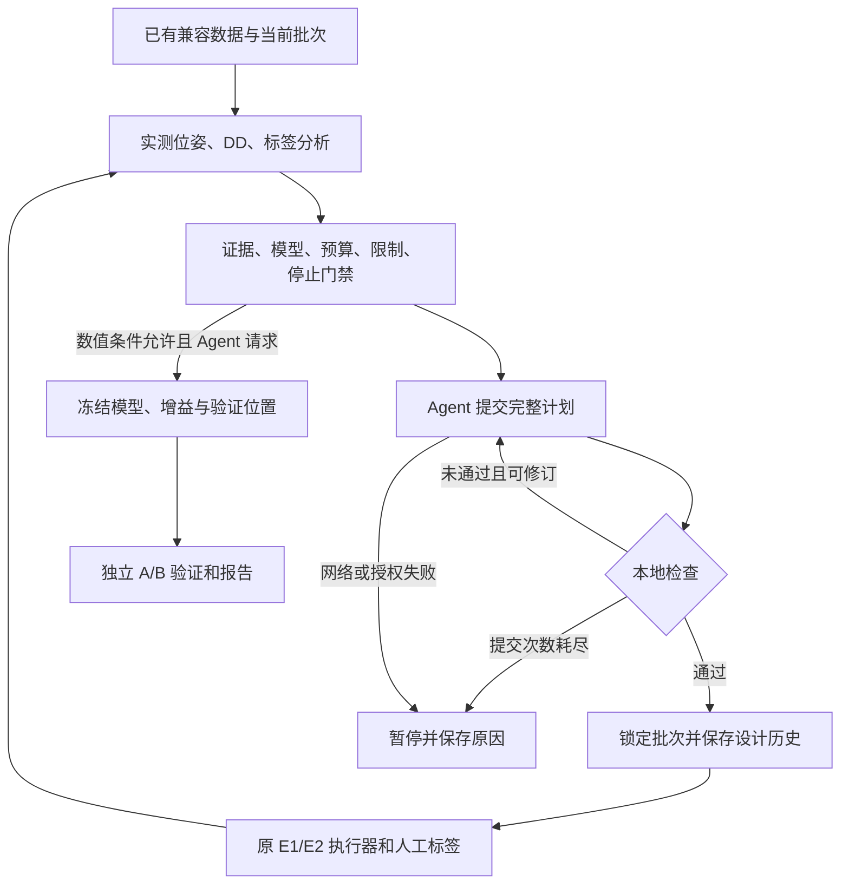

# Agent 自拟采集计划：协议、限制与停止条件

本说明对应 2026-10-30 的 `planning.mode: agent`。日常启动、账号连接、人工标签和恢复步骤见 [Agentic 操作指南](../AGENTIC_GUIDE_zh.md)。[原自适应设计说明](AGENTIC_ADAPTIVE_20261030.md) 保留为旧 `candidate` 模式记录，其中中点、间隔减半、候选排序等规则不限制本页的新模式。

## 1. 这一轮由谁决定什么

Agent 直接制定完整下一批实验：选择 A 或 B，给出各点 a 轴偏移和重复次数，解释假设、引用已有证据、说明预期能区分什么。本地提供的 `optional_examples` 是参考示例，不是白名单。Agent 可以提出没有出现在建议中的点位、非均匀间隔以及不同重复数，不要求取中点或把旧间隔减半。

本地程序负责读取和分析原始记录、验证计划、计算监测与预算、锁定模型和计划，再调用原 E1/E2 执行器。Agent 不生成 ROS 命令，不改力限、速度、开度下限、TCP 到位容差或异常处理，也不改人工标签和独立验证规则。



实验仍只有固定 T0 下的 a 轴平移；不增加旋转、l/c 扫描或自动瓶位检查。你继续负责摆瓶、换瓶、标签、复位和中断后的现场恢复。

## 2. 启动与旧数据复用

在 5090 项目目录，由现场操作员启动：

```bash
bash run_on_5090.sh agentic run --real \
  --seed-session outputs/e1e2_A_formal01 \
  --out outputs/agentic_planning01
```

这会使用现有 A 数据初始化，不要求重新做已有种子。可以重复指定 `--seed-session` 加入同一 T0、硬件和采集协议下的其它 A/B 数据。A 的有效初次 PROBE 用于映射，B 用于诊断纠正表现；不同瓶位、T0 或协议的数据不能强行合并。

现有 Robot Supervisor Probe / Sign in with ChatGPT 授权继续使用，不需要因为规划方式变化重新注册应用。授权和代理命令见操作指南。

**只有新建 campaign 默认采用 `planning.mode: agent`。** 已有 `campaign.json` 缺少该字段，或值为 `candidate` 时，续跑仍走旧候选选择协议。更新代码不会静默转换旧快照。需要新模式时，用新的 `--out` 并导入兼容旧数据；不要直接编辑旧 campaign 的快照来迁移。

```bash
bash run_on_5090.sh agentic status --out outputs/agentic_planning01
bash run_on_5090.sh agentic plan --out outputs/agentic_planning01
bash run_on_5090.sh agentic resume --real --out outputs/agentic_planning01
```

`status` 显示计划模式和当前设计。`plan` 在新模式中只读展示 `planning_context` 和 `optional_examples`，不请求 Agent、不写入可执行批次、不发送动作。`resume` 继续原批次和固定 T0；暂停后的首段运动仍需现场确认。

## 3. Agent 的计划协议

返回值必须是严格 JSON，顶层字段只有 `action`、`reason`、`plan`。本地 provider 可附加 `_meta` 审计信息，但它不是 Agent 的计划字段。

| 字段 | 规则 |
|---|---|
| `action` | `propose_batch`、`freeze` 或 `pause` |
| `reason` | 非空中文理由 |
| `plan` | 提批次时为下述完整对象；冻结或暂停时必须为 `null` |
| `plan.cond` | `A` 或 `B`，一批使用同一条件 |
| `plan.cells` | `[{"offset_mm": 数值, "reps": 整数}, …]`，每点总次数按轻重瓶各半 |
| `plan.model_id` | A 为 `null`；B 为已批准模型的 ID |
| `plan.gain` | A 为 `1`；B 为配置许可增益，默认从 `0.5/0.75/1.0` 中选择 |
| `plan.hypothesis` | 这批要检验的具体假设 |
| `plan.evidence_refs` | 引用本轮上下文中真实存在的证据 ID |
| `plan.expected_outcome` | 哪种观测支持或反对假设，预期新增什么信息 |

例如，一批可以在某局部提出 3 个非均匀点，各做 2、4、2 次；是否获准取决于当时范围、预算和证据，不取决于它是否出现在本地建议列表中。重复次数是该偏移的总次数，不是每种瓶子分别做这么多次。

拒绝额外代码、命令或修改控制配置的字段；拒绝非有限数、重复键、错误字段和无效证据引用。当前接入使用严格 JSON 解析与本地字段检查，不宣称服务端已启用结构化解码。

## 4. 本地硬检查与计划修订

每份计划都检查：

1. 格式、有限数值、证据引用、批准模型与许可增益。
2. 点位不重复，同批互异点名义间距默认至少 0.5 mm；每点次数为至少 2 的偶数。
3. 固定硬范围、累计研究范围、单侧扩展限制，以及原执行器的名义目标检查。
4. 正式次数不超过单批上限，默认 12；加上自动插入的零点监测后，不能超过剩余探索预算。
5. 已知 T0 时，检查抓取、退让和提起的名义目标；尚未取得 T0 时，实机初始化后仍需复核。

`planning.max_attempts: 3` 表示**一轮最多 3 次提交：首次提案加最多 2 次修订**。本地拒绝后，把具体原因交回 Agent，要求重交完整计划。连续不通过就暂停，未通过的提案不会交给执行器。

网络、授权、限流 429 和服务流中断不属于计划修订错误，立即暂停。不会在 ChatGPT 失败后悄悄换成本地规则。只有操作员明确选择 `--provider deterministic` 时才使用规则基线，该模式会明确标记未使用 LLM。

原始无效模型文本不会作为执行计划保存；审计中保留安全的解析错误。通过格式检查的提案，即使因预算或几何限制被拒绝，也保留提案和具体检查结果。

## 5. 范围可以增长，下一批可以只测局部

| 项目 | 含义 |
|---|---|
| `scope.min_mm / max_mm` | 固定硬边界，默认沿 a 的 −25 至 +25 mm，整个 campaign 不自动改变 |
| `design.min_mm / max_mm` | 已接受的累计研究范围，始终包含 0，不因局部采样或失败而缩小 |
| `plan.cells` | 下一批实际要测的具体位置，可以只覆盖累计范围的一部分 |
| `design.step_mm` | 设计历史中的名义间距，不是强制均匀网格，也不是实测空间分辨率 |

初始范围从兼容 A 的有效实测位置推断，起始档距取已有不同档位间隔的中位数；有效 A 不足时，使用 −2 至 +10 mm、2 mm 名义间隔的冷启动起点。创建时用 `--scope -2 10` 等参数可进一步限定硬边界，不表示立即扫描整个区间。

新范围取旧范围与获准计划的并集。Agent 可以只在 0 附近补点，但这不会把原来远端的失败记录和必测范围删掉。只有获准计划被保存为批次时，才更新 `design` 和 `design_history`；拒绝提案和只读查看不扩展研究范围。

扩展只允许 A 批次，每轮最多向一侧扩展 5 mm，不能一轮同时外扩两端。**这是显式探索幅度限制，不是无碰撞、可接触或可抓取保证。** 失败和执行跳过是分析证据，Agent 应解释其含义；不能把高度限制或运动未完成直接称为触觉能力边界。

B 可以在累计范围内检验纠正表现；超出模型已学习支持范围时，本地会给出警告，在线纠正器仍拒绝外推。B 纠正器不接收本次真实 δ 或位姿真值，只根据当前触觉和已批准模型决策。

原 **2 mm TCP 到位容差**与力、速度、开度和高度限制不变。名义点距为 0.5 或 1 mm 时，应同时看实际 TCP 档位分离和触觉噪声，不能据计划密度声称实现了同等分辨率。实际 TCP 位移也不等于瓶子被推动后的真实相对偏移。

## 6. 正常冻结需要什么证据

Agent 的 `freeze` 只有数值停止门禁已允许时才有效，不能单凭文字理由结束探索。门禁同时要求映射质量/覆盖达标和当前模型的前瞻 B 证据。

前瞻 B 规则如下：

- 必测偏移由固定验证规则按当前累计研究范围确定，默认共 5 个，包含两端与 0；不是由 Agent 只选容易点。
- 只使用当前模型版本、同一个许可增益的已完成探索 B 批次，不跨模型或增益拼接。
- 每个必测偏移的 light/heavy 都达到 `learning.min_B_per_cell`，默认各至少 1 次；至少达到 `learning.min_B_batches`，默认 1 个有贡献批次。
- 每档先分别计算两种瓶子成功率，再等权平均，均需达到 `validation.success_target`，默认 80%。
- 作废、记录不完整、零点监测和最终独立验证数据不充当上述前瞻覆盖。失败但有效的正式记录保留在成功率分母中。

更换模型版本或增益后，相应缺失的组合会重新出现在 `stop.required_B_cells` 和 `B_evidence` 中。研究范围扩展时，必测位置也按固定规则更新。只有最终冻结后才锁定验证位置，不再随新结果改变。

这个门禁用于判断是否进入独立验证，**不是置信区间意义上的性能保证**。默认每种瓶子各 1 次的证据很少，不能把探索通过当成“成功率已经至少 80%”。

## 7. 预算结束与独立验证

默认总预算为 120 次新增尝试、10 个探索批次和 4 小时。已有种子不计入新增次数；自动零点监测计入预算。批次和总预算按实际计划展开计算，不只数 Agent 提案里的正式点数。

正常冻结使用满足门禁的当前模型和同一增益。预算触发时也可把当前可用模型锁定用于检验；如果探索门禁尚未满足，就标为 **provisional（暂定）**，保留 `freeze_trigger`、`exploration_eligible` 和缺失证据，不能声称已经收敛或没有数据值得补。没有可用模型、时间不足等情况下，也可能停止而未完成独立验证。

最终模型、增益与验证点在 `frozen.json` 锁定，之后验证结果不反过来修改它们。默认：

- 按最终当前范围取 5 个位置，包含两端与零点。
- 每位置 A、B 各 4 次，轻重瓶各半，共 40 次正式试验。
- 默认每 10 次插入零点监测，共 4 次，总计提前预留 44 次。

改变验证点数、次数或监测频率时，预留次数相应重算。零点监测不混入最终每档成功率分母。

每档某条件只有 4 次时，即使 4/4 成功，**95% Wilson 下界也只有约 51%**，不足以证明真实成功率至少 80%。报告应区分 `complete`（流程完成）、`passed`（统计验收通过）、`inconclusive`（证据不足）与 `not_met`（未达到标准）。5 个测点只支持已测位置的结论，不能证明连续整个范围，更不代表整个 ±25 mm 硬边界都达标。

## 8. 怎样追溯 Agent 的每次决定

| 文件 | 内容 |
|---|---|
| `campaign.json` | 计划模式、固定配置、当前设计、设计历史、预算、状态和断点 |
| `analysis/latest.json` | 本轮数据诊断、覆盖和模型质量 |
| `analysis/candidate_checks.json` | 本地参考建议；新模式中不构成可执行点位白名单 |
| `decisions/NNNN_input.json` | 本轮初始证据、约束、参考建议和停止门禁 |
| `decisions/NNNN_attempt_XX_input.json` | 每次提案/修订实际提供的上下文，包含上次拒绝原因 |
| `decisions/NNNN_attempt_XX_proposal.json` | 能保存为严格有限 JSON 的提案；解析失败时可能不存在 |
| `decisions/NNNN_attempt_XX_check.json` | 是否通过、拒绝代码和原因或执行警告 |
| `decisions/NNNN_decision.json` | 本轮通过的最终决策 |
| `decisions/NNNN_validated_plan.json` | 通过本地校验的完整可执行计划；冻结/暂停时没有新批次 |
| `batches/NNNN/batch_plan.json` | 锁定的逐试验计划和提案来源、设计前后值 |
| `frozen.json` | 模型、增益、最终验证点、冻结原因与探索证据 |
| `validation/report.json`、`REPORT.md` | 独立验证统计及总体结论 |

例如，想知道 Agent 为什么在某局部追加 4 次，先看该轮 `hypothesis/evidence_refs/expected_outcome`，再看 `attempt_XX_check.json` 和对应批次结果；不能只看一句自然语言理由。无效提案、预算结束和执行约束均保留记录，不改写成性能结论。

本页描述的是规划与执行的分工和可检查规则；离线或模拟流程通过不等于实机性能通过。实机结论仍以完整采集记录、人工标签和独立验证报告为准。

## 本次验证记录

- 在 5090 现有容器的独立源码目录执行 **328 项离线测试，全部通过**。覆盖新计划协议、证据引用、任意非均匀点位、有限修订、断网暂停、审计中断续写、监测预算、固定运动限幅、B 覆盖、原 E1/E2 与 move-tcp 回归。没有运行实机运动。
- 使用已有 Robot Supervisor Probe 授权，实际调用 `gpt-6.1-sol`，执行端明确为 `--simulate`。完整走通 **A → A 补采 → B → Agent 请求冻结 → 独立 A/B 验证**，合计 **83 条合成试验**。
- 第二轮 Agent 自行提出 **+8.5 mm**，该点不在本轮 `optional_examples` 中；同时改变零点及 +10 mm 的重复次数，证明新接口不再是候选 ID 选择。
- Agent 冻结时本地探索门禁为真。最终独立验证结果仍如实记录为 **`not_met`**，没有因为流程完成或 Agent 请求冻结而改成性能通过。
- 原始验证记录在 5090：`outputs/agentic_planning_llm_20261030/`；其中 `decisions/0002_input.json` 与 `decisions/0002_decision.json` 可直接对照新测点，`frozen.json` 与 `validation/report.json` 可对照探索门禁和最终结论。

此记录验证软件闭环和真实模型接口，不提供新版本的实机抓取性能结论。
