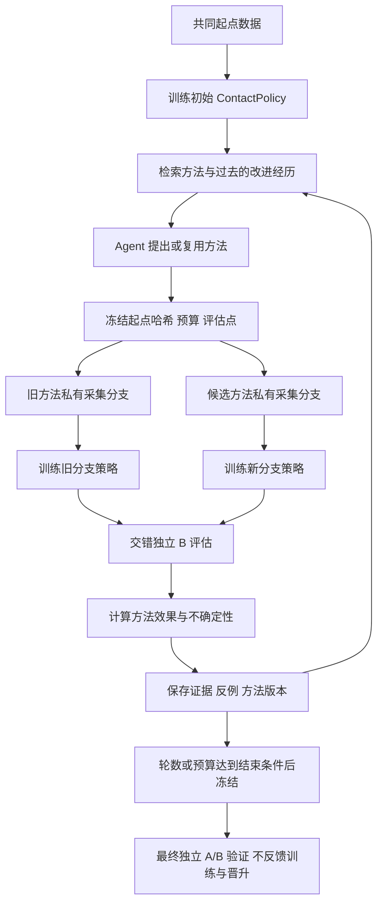

# RSI：方法经验、ContactPolicy 与独立对照

操作命令见 [RSI 操作指南](RSI_GUIDE_zh.md)。本文说明实现边界、数据流与可检验的结论。

## 两个更新对象

本实现分别保存：

1. **恢复策略 ContactPolicy**：根据当前两指触觉状态，输出有界的一维 a 轴恢复量。
2. **采集方法 Method**：根据已有证据决定怎样选择新的采集点、限制重复并覆盖未解决状态。

Agent 负责读历史、提出可证伪的方法假设；本地程序负责训练、执行约束、固定预算对照和从证据计算状态。Agent 不能通过修改成功标准、标签、安全参数或解释文本来晋升自己的方法。



旧 `agentic run` 的自拟批次功能保持原行为。新流程使用 `rsi` 或 `agentic rsi` 入口；不将旧会话原地转换。

## ContactPolicy 的实际学习任务

当前策略族为 `numpy_tanh_mlp_ensemble`：带线性跳连的 tanh MLP 集成，权重由 NumPy Adam 训练。默认 5 个成员、每个隐藏层 16 单元，`config.rsi.yaml` 默认 500 epochs；配置、归一化参数、网络权重和验证信息保存在内容校验过的 JSON 模型中。

默认输入为每指 10 个当前 PROBE 描述子，共 20 维：质心 u/v、外框四边、`log1p(area)`、二倍主轴角的正弦/余弦和角度是否可用。`contact_policy.dd_pool: true` 时，每指增加 4×4 数值池化，共 52 维。池化是扣除空载参考后的非负深度通道块均值，来源于已有服务提供的处理后 DD。旧数据没有相应池化特征时会被排除，不伪造零输入。

当前不训练力输入、腕部视觉输入、时间历史或多步 action chunk，也不导出 LeRobot。记录中存在这些原始模态，不代表当前模型会使用它们。单帧信息不足时，方法提案只能指出缺失能力并暂停；不能让提示词凭空增加时序感知或新探测动作。

默认 A 监督目标是：

```text
目标纠正量 = −(PROBE 实测 TCP − 固定 T0) 在 a 轴上的投影
```

它是几何回归目标，不是证明过的最优恢复动作，也不是瓶子被推动后重新测出的瓶子相对位置。倾倒、推动、作废、不完整记录、缺少实测 TCP 的样本不作为可靠几何监督；贴边状态由已有明确方向规则处理。

`include_successful_B` 默认关闭。若明确开启，只有测量与执行一致、最终成功、记录可靠的 B 恢复转移可以作为示范；标签仍应解释为“成功执行过的动作”，不能宣称最优动作。

在线 `ContactPolicy.decide` 只接收触觉描述子、接触状态和双侧接触布尔值，不接收计划 δ、绝对 TCP、试验编号或瓶子真值。预测通过范围与集成不确定性检查后，输出受原配置和模型动作上限共同限制的恢复量。无接触、停滞或贴边沿用已记录的方向恢复规则；观测不足/分布外/不确定性过高时拒绝学习策略动作。

初始训练留出优先按完整 session 分组；只有单个 session 时按完整试验组分组，并只按分组数量选择能满足样本数的拆分。RSI 随后冻结初始留出样本所属的完整组，两分支及所有预算检查点共用；新增采集加入训练，旧留出样本不因再次随机拆分转入训练。归一化、方向后备拟合和分布外支持集只用训练分割；保存的正是已做留出评估的权重，不在检查通过后又用全部数据重训。

默认最少 20 条合格测量样本，训练至少 12 条、留出至少 4 条；平均绝对误差门槛 2 mm、90 分位误差门槛 4 mm。具体值以模型 `settings` 为准。留出通过只说明当前几何监督的预测误差满足约束，恢复成功率需要后续实机 B 评估。

## 方法能表达什么

每个方法包括 `name`、`parent_id`、`hypothesis`、`applicability`、`score`、`sampling`、`evidence_refs`、`expected_outcome`。父版本、证据引用、规范化内容和内容哈希形成可追踪的修改链。

可执行评分由有限 AST 组成：`feature`、`constant`、`add`、`mul`、`min`、`max`。特征只有：

| 特征 | 当前依据与解释 |
| --- | --- |
| `failure_rate` | 邻近测点的可用试验结果；无结果时使用显式先验，不能冒充实测失败率。 |
| `uncertainty` | 覆盖数量和映射留出误差的启发式指标；不是校准概率。 |
| `novelty` | 与已测名义 a 偏移的距离。 |
| `coverage_gap` | 轻/重瓶局部覆盖不足程度。 |
| `action_conflict` | 两指质心接近而实测 TCP 几何目标分歧的证据；不是已证明的最优动作冲突。 |

`sampling` 控制网格间隔、额外 a 轴点、每点次数上限和选点距离。名义间隔下限 0.5 mm；候选额外点要受 ±25 mm 总硬边界及本次更窄的研究范围限制。实际执行仍受原运动/高度/力/开度限制。请求 0.5 mm 间隔不是证明机器人达到了 0.5 mm 分辨率。

选择器按评分与固定随机种子排序，并对重复访问施加明确惩罚；每次按轻/重瓶成对分配。候选约束无法填满约定预算时拒绝，不用偷偷增加重复或随机补点来掩盖方法不可执行。

Agent 可以构造新的评分组合与采样规则；它不会自动获得无限新算法、修改模型结构的代码执行能力或任意实验动作。超出已有特征与动作能力的问题应暂停，后续由实现与验证流程补能力。

对“观测相似而恢复动作不同”的解释必须保留替代假设：质心压缩丢信息、缺少历史、瓶位漂移、噪声、多种动作均有效。当前冲突分数用于选出值得研究的状态，不能把这些替代原因已经解决当成前提。

## 等预算方法对照

旧方法 `old` 和候选 `new` 各自从相同的 `base_sessions` 开始，只把本分支新采集数据用于本分支训练。共同起点策略内容哈希被记录在协议中。当前训练器按相同训练配置与随机种子对各自完整训练集重新训练，不是从该策略的权重做增量 warm-start。

每次对照开始前，`protocol.json` 固定：

- 任务 ID、模拟/实机属性；
- 起点数据 manifest 的哈希 `initial_dataset_hash`；
- 共同策略的内容哈希 `initial_policy_hash`；
- 每分支采集预算 `collection_budget`，包含约定的零点监测；
- 训练预算/超参数；
- 预定评估点、轻重瓶与每格次数；
- 最低评估样本数、效果门槛和独立评估标记。

两分支的采集分批交错，B 评估也交错，减少时间漂移造成的混淆。A/B 在这里是采集或恢复条件；它们和 `old/new` 方法分支独立。

所有新增尝试计入总预算，包括中断尝试和零点监测。方法比较要求两分支实际支出与预定固定预算相符；额外中断使对照条件不满足时，不隐去这次成本来声称新方法更有效。无效或缺失的评估记录也不会冒充合格样本。

成功要求记录完整、人工标为正常、已提起、完成 HOLD 且未掉落。比较采用各分支成功率的 Wilson 95% 区间，构造保守差值区间；只有区间支持超过预定 `min_effect` 的优势并满足最低样本数，才认定某分支较好。默认每分支 20 条评估样本和 0.05 效果门槛通常不足以证明微小改进，应接受 `inconclusive`。

比较结果属于方法开发证据，可以在下一轮被检索。默认在每分支累计新增 12、24 次 A 采集时分别训练和做开发 B 评估，输出学习曲线 JSON/PNG、描述性曲线面积，以及观测成功率首次达到 80% 的检查点预算。本轮中间评估结果不进入本轮后续采集规则或训练；只有预注册最后检查点参与方法胜负判定。最终 A/B 验证在策略冻结后进行，不进入训练、选法或方法晋升。两个检查点不能证明理论最少样本量，开发曲线也不等于独立最终证据。

## 记忆、复用和递归更新

方法库是跨 session 的独立目录，默认 `outputs/rsi_method_memory/`。方法与经历使用内容哈希、原子写入和本地文件锁保存。经历记录问题、诊断、对照起点、结果及证据路径；状态由程序重新计算，不接受 Agent 写入“已成功/已晋升”声明。

检索先区分模拟/实机及硬件协议，再按问题上下文关联程度排序；返回支持性证据与反例。方法即使曾经有效，也要再次检查适用性。状态包括 `pending`、`current_task_valid`、`cross_task_valid`、`not_supported`、`contested`。

三种模式用于区分经验带来的作用：

| 模式 | 行为 |
| --- | --- |
| `recursive` | 每轮重新检索当前长期方法库，允许提出子方法、对照验证并将经历供后续轮次使用。 |
| `fixed` | 从创建时的检索快照选取有验证证据的推荐方法，没有时使用基准方法，并冻结它。每轮仍做同样预算的两分支采集/训练/评估；同方法分支仅用于重复性控制，不产生方法晋升。实际方法 ID 写入 `rsi.json`。 |
| `none` | 本任务不向提案 Agent 提供跨任务经验库；仍能看到本任务数据和当前方法、提出并评估方法，是无长期经验的控制。 |

这些模式仍会保存本次证据供审计；`none` 不等于删除原始数据。Agent 在普通递归模式选择复用当前方法时，也做等预算同方法重复对照，不直接跳过该轮。相同方法的分支不是新旧方法优劣证据；保留旧分支的数据继续后续流程。一次不同方法比较没有胜出时，当前方法不被替换，但相关经历仍可进入递归模式的下一次诊断。方法成功/失败记录并存时，状态为 `contested`；需检查是条件变化还是旧方法失效。

`cross_task_valid` 要求至少两个不同的显式问题签名有支持性对照，并符合证据范围。新建任务时可用 `--problem` 声明真实问题差异，问题签名由描述及研究范围生成。默认没有显式问题声明时，多个输出目录或任务 ID 的胜绩仍只属于当前任务有效。人工描述必须与实际实验一致，不能通过改名伪造迁移结论。

每轮创建时固定时间戳，写入改进经历；检索后的有限提示内容按经历时间裁剪，确保最新改进和反例有机会进入下一次提案。原始完整经历不从方法库删除。

## 实际提示与调用审计

`bottle_scan/rsi_proposer.py` 的 `RSI_SYSTEM` 专门要求 Agent 研究“如何更有效获得恢复能力”，包括父方法不足、历史反例、可证伪机制、适用条件、等预算验证和缺失观测的替代解释。

每轮完整输入含本任务统计、可计算特征、检索经验、可用方法 ID、证据 ID 与固定比较协议。完整输出严格限定为 `propose_method`、`reuse_method` 或 `pause`。新方法通过 JSON、字段、有限数值、AST、父版本与引用检查后，只是“可用于对照”，不是“已验证有效”。

原 ChatGPT 登录、代理和 Responses 连接被复用。没有给模型开放 shell、ROS 或任意代码工具。网络/授权/未完成推理立即暂停；只有完整输出的格式或协议错误允许最多三次修订，不以本地规则伪装模型成功。

`prompt_buffer/` 是可审计的实际请求档案；长期方法库保存跨轮经验。这两者与本次聊天历史不同：你在聊天里说的话不会自动成为机器人 Agent 的长期记忆。

成功决策的 `*_decision.json` 中包含完整 `audit`：系统提示词快照及 SHA256、实际输入 JSON 与哈希、各次响应/驳回、经过筛选的模型元数据。失败带审计时保存单独 `*_audit.json`。输入不含登录凭据，审计不复制令牌、HTTP 头或原始异常详情。

`--provider deterministic` 或 `mock` 明确不调用 LLM，只复用已有明确允许的方法或暂停，不能用它们证明 Agent 发明了新方法。模拟产生的策略与经验不会被当成实机通过证据。

## 数据与证据目录

```text
outputs/rsi_contact01/
├── rsi.json                         # 配置快照、T0、断点、方法/策略ID、所有批次与循环
├── REPORT.md                        # 可重新生成的汇总报告
├── .rsi.lock                        # 同一会话的进程锁
├── prompt_buffer/
│   ├── 001_<time>_context.json      # 发起提案时的统计与检索上下文
│   ├── 001_<time>_decision.json     # 决策；真实推理含完整audit
│   └── 001_<time>_audit.json        # 有审计的失败请求；仅失败时出现
├── cycles/
│   └── 001/
│       ├── protocol.json           # 实验前冻结的共同起点和预算/评估协议
│       └── comparison.json         # old/new原汇总、计算结果和证据哈希
├── models/
│   └── <model_id>.json              # 模型权重、特征顺序、数据来源、留出与校验
├── batches/
│   └── <batch_id>/
│       ├── batch_plan.json         # phase/branch/cycle/plan/model/hash
│       ├── session_meta.json       # 兼容E1E2格式、角色、配置、T0、恢复上下文
│       ├── progress.json           # 完成ID、活动试验、airborne/unsafe_recovery
│       ├── summary.csv             # 每次试验一行
│       ├── trials/<trial_id>/
│       │   ├── meta.json           # 标签、阶段、接触/重抓、几何监督来源
│       │   ├── streams.h5          # 原服务数据与时序流
│       │   ├── recording_status.json
│       │   └── images/             # 腕部等选定时刻关键帧
│       └── interrupted/            # 被归档的未完成尝试，仍计预算
├── errors/<time>.json              # 暂停原因
└── recovery_acknowledgements/       # 人工恢复声明及恢复前状态（如果执行过）

outputs/rsi_method_memory/
├── methods/<method_id>.json         # 规则、父版本、假设、适用范围和证据引用
├── experiences/<experience_id>.json # 改进经历与可重新计算的比较证据
└── .lock
```

训练模型通过 `source_trials`、`metadata_sha256`、`measurement`、`label_source` 和 `training_snapshot_sha256` 追溯实际使用的样本、目标与特征；未使用数据及排除原因另外统计。

`rsi.json` 的种子 manifest 固定会话元数据、逐次元数据、记录状态及被使用的实测 TCP 数值。它没有逐字节哈希整份多 GB 的 DD/图像文件。因此这些哈希能帮助发现已消费证据的修改，不能宣称是全部原始传感数据的完整防篡改证明；拥有文件写权限的人仍可能改动文件。备份应包括种子数据、新批次和方法库。

保存的“原始”指服务交付给采集程序的内容：DD 已经经过 X5 服务处理；六维力、法向力、位姿、开度按现有采集频率记录，图像采用现有关键帧策略。当前改造未增加连续视觉录像或跨设备硬件同步，不会补回历史没有记录的帧。

`batches` 的 `phase` 区分 bootstrap、collection、evaluation、final_validation；metadata 的验证角色也会被训练读取器检查。不能靠手动复制验证文件到普通目录来把最终评估结果加入训练。新研究可以重新设计数据划分，但必须作为新协议明确记录。

## 执行与恢复边界

RSI 编排模块本身不发布机械臂命令；只有显式 `run/resume --real` 经已有执行器进入运动流程。首段/恢复后的授权、命令源检查、力上限、开度限制、TCP/高度/提起限幅、传感器新鲜度、记录队列异常和空中恢复处理保留。

暂停和网络错误不会主动改 T0、换模型或降低安全门槛。未处理的空中状态阻止续跑；`rsi recover` 仅记录现场已处理的声明。普通状态查看、报告、训练和经验查看不执行机器人运动。

研究结论应分别写清：策略在什么观测条件下具备什么恢复能力；方法在相同预算下是否帮助获得这项能力；相关经验面对新的问题是否仍有帮助。本实现提供记录与检验这些问题的闭环，不因流程名称为 RSI 就自动证明递归自我改进成立。
